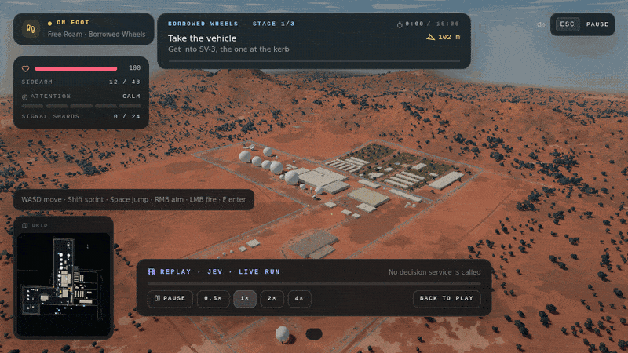
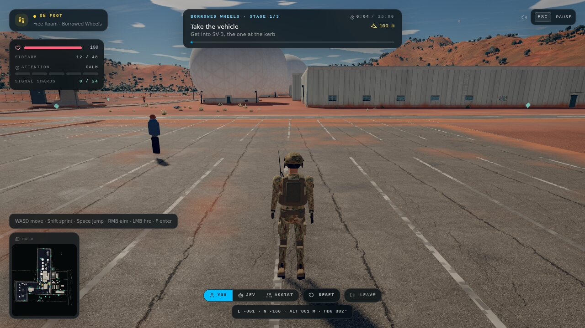
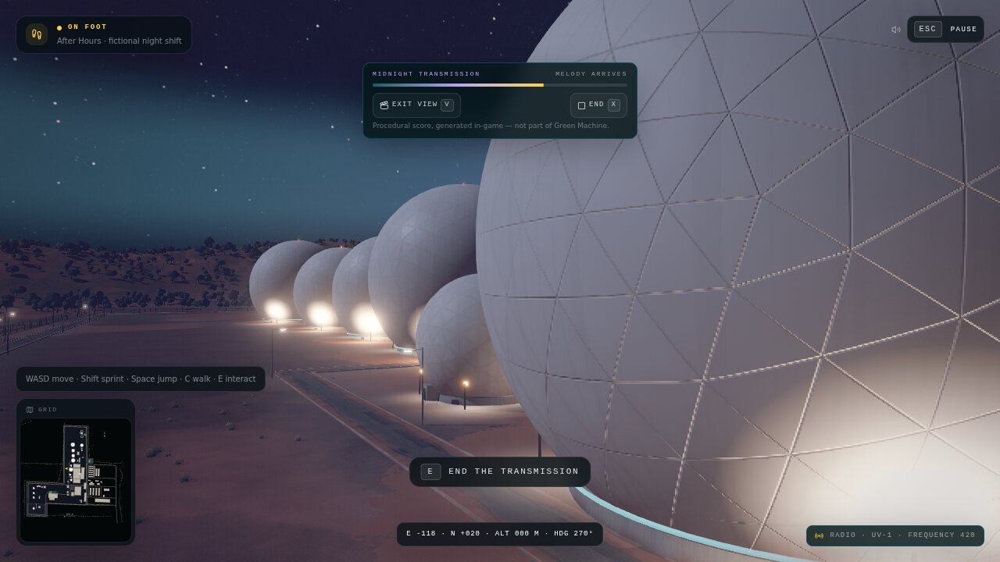
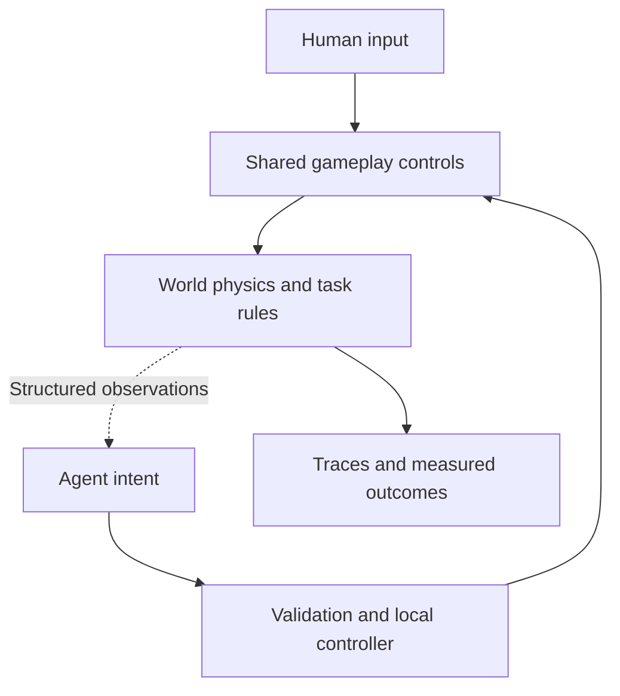

<h1 align="center">Satellite Vision Scape</h1>

<p align="center"><strong>Give an agent the controls. Let the world judge the result.</strong></p>

<p align="center">
  A playable 3D world for studying how humans and AI agents act, fail and recover.<br />
  Built by <a href="https://github.com/topherchris420">Christopher Woodyard</a> at <a href="https://vers3dynamics.com">Vers3Dynamics</a>.
</p>

<p align="center">
  <a href="https://geotwn.vercel.app/"><strong>Play in your browser</strong></a> ·
  <a href="https://geotwn.vercel.app/?controller=mock"><strong>Watch the scripted baseline</strong></a> ·
  <a href="#recorded-runs"><strong>Inspect the evidence</strong></a> ·
  <a href="#run-locally"><strong>Run locally</strong></a>
</p>

<p align="center">
  <a href="docs/media/jev-free-roam-live.mp4">
    
  </a>
  <br />
  <sub>Recorded Jev run · Borrowed Wheels · 3 October 2026 · replay rendered at 8× speed. Click for the MP4. This is a saved run, not a live inference feed.</sub>
</p>

**Satellite Vision Scape turns a game into an instrument for observing agent behaviour.** Walk through a reconstruction of Pine Gap, get behind the wheel, deliver a coffee without spilling it, or follow a radio signal into a midnight concert. Then give an agent the same task and inspect what actually happened.

A human and an agent share the world's controls, physics, collisions and task rules. The agent chooses an intention; local controllers carry it out; the simulation determines the outcome. Decisions, handovers and results become exportable traces.

**Status:** experimental. One site, two task modes, recorded live-model sessions and scripted experiments. The agent receives structured observations and uses local movement controllers, so these runs measure decision-making within that setup—not human-equivalent perception or motor skill.

[Explore the world](#explore-the-world) · [Controls](#controls) · [How it works](#how-it-works) · [Recorded runs](#recorded-runs) · [Development](#development) · [Documentation](#documentation)

## Explore the world

Human play and the scripted baseline need no API key. Open the [browser experience](https://geotwn.vercel.app/) and choose a mode on the briefing card.

| Experience | What you do | What it makes observable |
| --- | --- | --- |
| **After Hours** | Deliver coffee across the site, decode a radio clue, tune four signal terminals and reach a midnight concert. | Planning across stages, smooth driving, feedback-based tuning and knowing when to wait. |
| **GTA-Style Free Roam** | Choose one of 14 seeded scenarios, including free play. Walk, drive, interact with traffic and pedestrians, and attempt challenges with a human, Jev or a scripted controller. | Navigation, vehicle handling, aiming, recovery and the consequences of actions. |
| **Explore, Tour and Plan** | Fly over the site, take a camera tour or inspect the overhead plan. Select a structure to see its source dossier. | The historical reference behind the scene, separated from the fictional gameplay. |

**Start with After Hours.** Collect the coffee at the canteen cart, find a vehicle and follow the objective. The cup reacts to braking, cornering and impacts. After delivery, switch the radio to the Numbers Station and follow its captioned clue.

To watch the same journey without a model key, [open the scripted baseline](https://geotwn.vercel.app/?controller=mock) and press **After Hours**. It is a hand-written policy, clearly labelled in the interface.

The vehicle radio features **_Green Machine_ by Indigo People**, original music written by **Christopher Woodyard**. The puzzle and concert use a separate procedural score. [Soundtrack, credits and permissions →](docs/SOUNDTRACK.md)

<details>
<summary><strong>A closer look at the world</strong></summary>

<table>
  <tr>
    <td width="50%"></td>
    <td width="50%"></td>
  </tr>
  <tr>
    <td align="center"><sub>Free Roam: the same avatar for human and agent.</sub></td>
    <td align="center"><sub>After Hours: four signals become one composition.</sub></td>
  </tr>
</table>

</details>

### Controls

| Action | On foot | In a vehicle |
| --- | --- | --- |
| Move / drive | `W A S D` | `W` accelerate · `S` brake / reverse · `A D` steer |
| Look | Mouse | Mouse |
| Sprint / walk | `Shift` / `C` | — |
| Jump / handbrake | `Space` | `Space` |
| Interact / enter / exit | `E` | `E` |
| Headlights | — | `L` |

**General:** `Esc` pauses and releases the mouse; `M` mutes; the mouse wheel adjusts camera distance. `1`–`4` select Play, Explore, Tour and Plan. **Press `H` to reclaim control while an agent is playing.**

**Free Roam:** `Q` or right mouse aims; `Z` or left mouse fires; `F` also enters/exits vehicles. `J` requests Jev control and `K` enables Jev assist. See the [Free Roam guide](docs/FREE_ROAM.md) for modes and scenario rules.

**Touch and performance:** touch controls provide movement, drag-to-look and action buttons. Phones and coarse-pointer devices start at Low quality before the 3D scene mounts, with reduced rendering resolution and shadows disabled. A WebGL-capable browser is required; performance still depends on the device. If the scene struggles, choose Low quality in the viewer.

<details>
<summary><strong>After Hours: radio, accessibility and saved progress</strong></summary>

| Control | Action |
| --- | --- |
| `R` | Radio power; retry playback if the browser blocked it |
| `T` | Next station |
| `,` / `.` | Previous / next album track |
| `[` / `]` | Tune the receiver |
| `-` / `=` | Music volume |
| `A D` or arrow keys | Turn a terminal dial while its panel is open |
| `Y` | Retry the coffee delivery |
| `V` / `X` | Toggle the concert camera / end the transmission |

Pause → **After Hours → Settings** offers reduced motion, clean audio, signal guidance and effect intensity. Radio clues have captions; terminal feedback includes waveforms, meters and text, so the journey can be completed muted.

After Hours saves progress and preferences in browser storage and resumes at safe checkpoints. **Run traces are separate: export a trace before leaving if you want to keep the session's evidence.**

</details>

## How it works

**An agent cannot declare its own task complete.** Progress comes from the game's ordinary interaction and simulation code.



- **Shared mechanics.** Humans and agents use the same world and fixed 120 Hz simulation. Agent code issues controls rather than writing positions, changing collisions or marking objectives complete.
- **Bounded decisions.** The runtime checks the response schema, the offered options and whether the action remains legal when the answer arrives. Stale or rejected responses are recorded.
- **Human authority.** Take over in the current world, with the same vehicle, momentum and progress. After Hours co-pilot suggests a move and acts when delegated; Free Roam assist can add bounded corrections while the human plays.
- **Inspectable records.** Traces distinguish choices, execution outcomes, failures and control changes. The experiment tools read measurements from those traces.

The shared world does **not** make the two controllers identical:

| | Human | Agent |
| --- | --- | --- |
| Perception | Rendered scene, audio and interface | Bounded structured observations of player-visible information |
| Movement | Direct steering and movement input | Intent translated into controls by a local executor |
| Decisions | Continuous player input | Discrete choices, with provider latency |
| Outcome | Determined by the simulation | Determined by the same simulation |

The local planner, driving controller and prompt assists contribute to performance. They must be considered alongside the model when interpreting results. [Runtime contracts and authority boundaries →](docs/AGENT_RUNTIME.md)

## Recorded runs

These measurements come from committed traces. They describe individual historical sessions, not a success rate or a claim about the current model.

| Recorded live Jev session | Task result | Task elapsed | Decisions | Collisions | Human interventions |
| --- | --- | ---: | ---: | --- | ---: |
| [After Hours · 27 September 2026](docs/traces/jev-after-hours-live-2026-09-27.json) | Complete; 100% coffee delivered; all four terminals and concert completed | 457.82 s | 212 | 0 | 0 |
| [Borrowed Wheels · 3 October 2026](docs/traces/jev-free-roam-borrowed-wheels-live-2026-10-03.json) | All three stages completed | 143.6 s | 126 | 1 pedestrian collision | 0 |

**Completion is only one measurement.** The Free Roam run above also records 17 hard-braking events. Keeping those outcomes beside the successful objective is part of the point.

The [After Hours case study](docs/JEV_AFTER_HOURS.md) includes an earlier run that stalled at a terminal and the changes that preceded the completed run. [Experiment reports](experiments/results/) examine control magnitude, tuning feedback, decision latency, travel review and human/agent comparison. No human reference run is currently committed for the After Hours comparison.

### Record and replay your own session

| Mode | Record | Replay boundary |
| --- | --- | --- |
| **After Hours** | Open `/?agentHud=1`, play, then choose **Export trace** in the agent panel. | `svs-agent-trace/v1` replay re-issues agent intentions through validation. It does not restore a world snapshot or replay human control segments. |
| **Free Roam** | Use the mode's run export and comparison controls. | `svs-freeroam-trace/v1` rebuilds the seed/scenario and replays recorded frame controls without model calls. State checkpoints report divergence. |

Free Roam replay depends on compatible simulation code and runtime behaviour. A recording can drift across builds or JavaScript engines; the [acceptance review](docs/FREE_ROAM_ACCEPTANCE.md) documents both matching replays and cross-engine drift. Metrics are computed by the client, not independently attested by a server.

## Run locally

Use **Bun 1.3+**, a Node.js version compatible with Vite 8 (**20.19+ or 22.12+**) and a WebGL-capable browser.

```sh
git clone https://github.com/topherchris420/satellite-vision-scape.git
cd satellite-vision-scape
bun install --frozen-lockfile
bun run dev
```

Open the URL printed by Vite. If your environment cannot bind IPv6, use `bun run dev --host 127.0.0.1`.

| Local entry point | Purpose |
| --- | --- |
| `/` | Human play and the mode selector |
| `/?controller=mock` | Scripted After Hours baseline; press **After Hours** |
| `/?controller=random&seed=42` | Seeded random After Hours policy |
| `/?agentHud=1` | Show the After Hours trace panel during human play |
| `/?controller=replay` | Import an After Hours agent trace |
| `/thesis` | The digital-twin motion piece |

### Optional: run Jev

Jev uses a **TypeSafe API key on the server**. Human play, local baselines and trace replay work without one. The UI reports when Jev is unavailable on a deployment.

Set these in your server environment, or in a local `.env.local` file (ignored by Git), then restart `bun run dev`:

```dotenv
TYPESAFE_API_KEY=your_key_here
TYPESAFE_MODEL=jev-latest
JEV_ASSISTS=full
```

Only `TYPESAFE_API_KEY` is required. `TYPESAFE_MODEL` defaults to `jev-latest`; `JEV_ASSISTS` defaults to `full`, with `lean` and `none` available for comparison.

Choose **Jev After Hours** or **Co-pilot**, or select a Free Roam challenge and **Let Jev Play**. Live decisions call the external API and may incur charges. Keep the key server-side; never use a `VITE_` prefix or commit credentials.

[Configuration and live-run instructions →](docs/JEV_AFTER_HOURS.md) · [Assist profiles and evaluation method →](docs/NEXT_MODEL.md)

## Development

**Stack:** React 19 · TypeScript · TanStack Start / Router · Three.js · React Three Fiber · Drei · Tailwind CSS 4 · Vite 8 · Bun.

### Checks

```sh
bun run test
bun run test:agent
bun run test:freeroam
bun run test:experiments
bun run typecheck
bun run lint
bun run build
bun run preview
```

The focused test commands are subsets of the full suite. Tests cover world interactions, agent authority, takeover, contracts, replay integrity and experiment definitions. `bun run verify:secrets` performs a separate production build with a canary credential and scans the output for leaks.

### Experiments

Inspect existing evidence or run a local, non-billable experiment:

```sh
bun run experiment list
bun run trace docs/traces/jev-after-hours-live-2026-09-27.json
bun run experiment tuning-control-magnitude --runs 3 --out experiments/results/local-tuning
```

The short experiment is marked partial. Its explicit output directory keeps the committed reference result intact. Full studies define an independent variable, paired seeds, measured outcomes and falsification criteria, with one hashed trace per run. Live experiments require explicit billable-provider opt-in. [Experiment workflow →](docs/EXPERIMENTS.md)

### Where to work

| Area | Entry point |
| --- | --- |
| World, physics, vehicles and interaction | [`src/game/`](src/game/) |
| After Hours and Free Roam task mechanics | [`src/game/afterhours/`](src/game/afterhours/) · [`src/game/freeroam/`](src/game/freeroam/) |
| Agent contracts, providers, execution and traces | [`src/agent/`](src/agent/) · [`src/agent/freeroam/`](src/agent/freeroam/) |
| Server-side Jev adapter | [`src/server/agent/`](src/server/agent/) |
| 3D scene and play interfaces | [`src/components/site/`](src/components/site/) · [`src/components/game/`](src/components/game/) |
| Historical manifest, terrain and spatial transforms | [`src/lib/`](src/lib/) |
| Experiment definitions, runner and reports | [`experiments/`](experiments/) |
| Capability probes and browser verification tools | [`evals/`](evals/) · [`scripts/`](scripts/) |

**Bring your own agent:** implement [`AgentProvider.decide()`](src/agent/provider.ts), receiving a validated observation and returning an intent or typed failure. Keep remote credentials in a server adapter. The [runtime guide](docs/AGENT_RUNTIME.md) covers contracts and extension points.

For a useful contribution, identify the mode and seed, export a trace, describe the expected and observed behaviour, and include browser/device details for rendering problems. Changes to agent behaviour should preserve ordinary input, human takeover and trace provenance.

## Historical reference and scope

Pine Gap is the first environment. Its antenna positions and diameters are anchored to the **February 2016 survey by Desmond Ball, Bill Robinson and Richard Tanter**, with source IDs retained in the scene.

| Layer | What the project represents |
| --- | --- |
| **Historical reference** | Published antenna coordinates and diameters, with a documented longitude correction for `98-A`. |
| **Approximate reconstruction** | Exterior shells, buildings, roads and fences derived from public visual context; synthetic terrain and vegetation. |
| **Fictional gameplay** | Characters, vehicles, coffee delivery, radio stations, signal terminals, crowds, pursuit, challenges and every agent action. |

This is a public-reference exterior reconstruction with invented game mechanics. It does not represent current operations, real access procedures or surveyed terrain, and buildings have no playable interiors.

The simulation uses stylised vehicle dynamics and simplified collision geometry. It is one authored setting, with no environment editor or multiplayer service. Its agent boundary is an application architecture, not a sandbox for untrusted code; live API limits are held in memory per server instance.

[Historical source and correction](docs/PINE_GAP_REFERENCE.md) · [Data sources](DATA_SOURCES.md) · [Provenance](docs/PROVENANCE.md) · [Free Roam limitations](docs/FREE_ROAM.md)

## Documentation

| Read this for… | Guide |
| --- | --- |
| Agent contracts, validation, takeover and evaluation | [Agent runtime](docs/AGENT_RUNTIME.md) |
| Jev configuration, recorded success and failure analysis | [Jev After Hours](docs/JEV_AFTER_HOURS.md) |
| Seeded scenarios, shared actions, replay and comparison | [Free Roam](docs/FREE_ROAM.md) · [Acceptance review](docs/FREE_ROAM_ACCEPTANCE.md) |
| Reproducible experiments and hypothesis tracking | [Experiments](docs/EXPERIMENTS.md) · [Research backlog](experiments/HYPOTHESES.md) |
| Prompt assists, capability probes and model comparisons | [Next-model method](docs/NEXT_MODEL.md) |
| Proposed mathematical extension; not yet tested | [Research proposal](docs/MATH_RESEARCH.md) |
| Terrain, spatial coordinates and data pipelines | [Terrain architecture](docs/TERRAIN_ARCHITECTURE.md) · [Spatial context](docs/SPATIAL_CONTEXT_ARCHITECTURE.md) · [Offline pipeline](docs/OFFLINE_TERRAIN_PIPELINE.md) |
| Music and asset permissions | [Soundtrack](docs/SOUNDTRACK.md) · [Attributions](ATTRIBUTIONS.md) · [Data and licence notes](docs/ATTRIBUTION_AND_LICENSES.md) · [Notice](NOTICE) |

**Separate project in this repository:** [99.9% SURE](gta-sa-99-9-percent-sure/README.md) is a Vers3Dynamics mission for a separately installed GTA: San Andreas PC game. It is not part of the browser experience; its guide distinguishes headless validation from in-game testing that remains outstanding.

### Credits and reuse

Created by **Christopher Woodyard / Vers3Dynamics**. **Jev** is provided by TypeSafe. Original recordings by **Indigo People** are used with the songwriter's permission; the procedural puzzle score is credited separately.

The repository currently has **no top-level `LICENSE` file**. Music, artwork, reference material and third-party data retain their own terms; public availability does not grant a single licence for everything. Consult the attribution and permission documents above before reuse.
