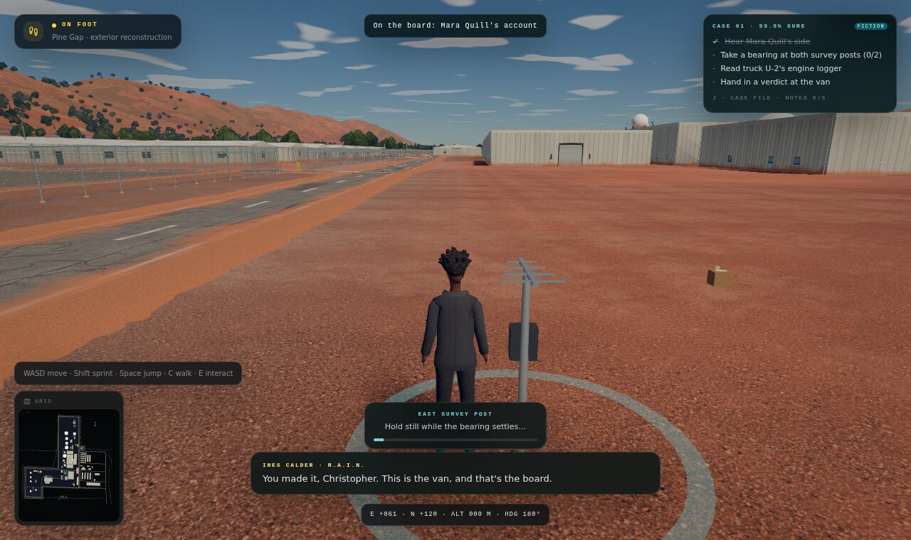
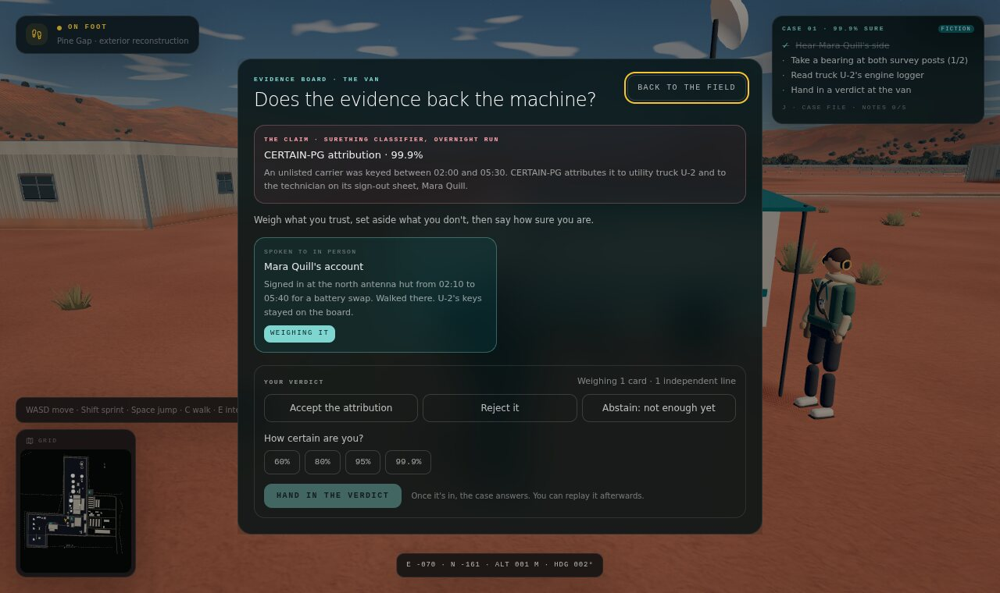
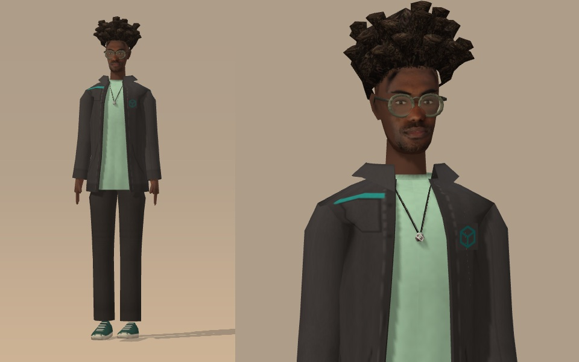

# Hidden campaign: developer notes

> **Spoilers.** This page explains the hidden content in Pine Gap. The README stays spoiler-free on purpose; keep it that way.

The design rule is: *do not turn Pine Gap into a game, reveal that Pine Gap contains one.* An ordinary visitor sees the same landing, survey interface, instruments and simulation as before. Nothing in the menus advertises the case. Curiosity finds it.

Everything in the case is fiction. The signal, R.A.I.N., CERTAIN-PG, SureThing and every person in it are invented, and every surface that shows them carries a Fiction tag. Nothing in it describes real equipment, interiors, operations or intelligence.

## How it is found

1. **The signal.** `SignalAnomaly` (`src/components/game/hidden/SignalAnomaly.tsx`) sits in the survey HUD's top-left column, under the site card. It renders nothing until the visitor has spent `SIGNAL_DWELL_S` (30 s) in a survey mode (Explore, Tour or Plan) or inspected `SIGNAL_INSPECTIONS` (2) different structures. It then shows one flickering readout line: an unlisted carrier at 1420.4 MHz, "conf 99.9%".
2. **The inspector.** Clicking the line opens a small panel that reads like the other instrument panels, with a Fiction tag and a note that the signal and everything it leads to are invented.
3. **The transmission.** "Open the transmission" types out R.A.I.N.'s message, ending "How certain are you?". "Go and look" starts the case from that click (so audio and pointer lock are allowed); "Not now" closes it.
4. **The way back.** Once the case has been found, the line shows at once on every later visit (read from the save), and the inspector offers "Resume the case" or "Return to the case". Leaving the case from its pause card keeps you in ordinary play; "Return to the survey" goes back to Explore.

The rules live in `src/game/hidden/discovery.ts`, which is the only hidden-case code in the main bundle (a few hundred bytes).

## Lazy loading and performance

- `SiteScene` imports the case module with `import("@/game/hidden/HiddenCase")` and the screens with `lazy(() => import(".../HiddenCaseHUD"))`. The acceptance click fetches both chunks. Waiting in Explore or simply reading the transmission loads neither chunk.
- Until then the case adds no geometry, no layer, no interaction provider and no per-frame work. `Game.addLayer` keeps an empty array on ordinary visits.
- The parked field van has a removable collision shape so Christopher, passing vehicles and the orbit camera stay outside its body. Returning to a survey view disables it, and leaving the campaign removes it.
- Christopher's figure (mesh about 180 KB, textures about 400 KB) is a separate chunk, `src/game/hidden/chris/loadChris.ts`, fetched when the case first starts. The default figure stands in until it arrives, and if it fails to load the case plays the same with the default figure.

## Architecture

| File | What it holds |
| --- | --- |
| `src/game/hidden/story.ts` | Pure data: places, people, evidence, dialogue, field notes, endings and `gradeVerdict`. No three.js. |
| `src/game/hidden/caseFile.ts` | The save (`CaseData`), its tolerant parser and every step that changes it. Pure. |
| `src/game/hidden/caseHud.ts` | The snapshot React reads (`CaseSnapshot`) and its store. |
| `src/game/hidden/HiddenCase.ts` | The running case. A `GameLayer` plus an interaction provider: people, bearings, captions, panels, saving, audio and the title and ending camera. |
| `src/game/hidden/HiddenCaseVisuals.ts` | The van, the three people, survey posts, bearing rays, the radiosonde, field-note crates and the logger tag. |
| `src/game/hidden/chris/` | Christopher as the player: `chrisw-mesh.json` (exported mesh and skeleton), `chrisData.ts` (decoding and checks), `ChrisVisual.ts` (skinned figure driven by `CharacterPose`), `loadChris.ts` (fetches the mesh and the mod's painted textures). |
| `src/components/game/hidden/HiddenCaseHUD.tsx` | Title card, objectives, captions, conversations, evidence board, verdict, ending, case file and the case's pause card. |
| `src/components/game/hidden/SignalAnomaly.tsx` | The signal, inspector and transmission. Ships with every visit, holds no game code. |

`Game` gained two generic hooks. `setPlayerVisual(figure)` shows another figure in the player's place (null restores the default); the caller owns it, and movement, seating and collision never read it. `addLayer(layer)`, with optional `update`, `fixedStep`, `present` and `cinematic` methods, called after Free Roam's. A layer's `cinematic` may take the camera (the title card and the ending orbit the van). `GameHUD` takes `caseActive` to hand its briefing and pause cards to the case.

### Authority and takeover

The case never drives the avatar or a vehicle. It only reads the player's position, offers prompts through `game.interaction.providers`, and locks movement while a panel or the title card is up (`lockMovement("hidden-case" | "hidden-case-title")`), always releasing input first. Starting the case stops Free Roam and After Hours, so no agent run is active alongside it; agent tools and human takeover are unchanged outside it.

## Mission 1: 99.9% SURE

CERTAIN-PG, a vendor's classifier, attributes an unlisted overnight carrier to utility truck U-2 and to the technician who signs it out, Mara Quill, at 99.9%. The player is Christopher Woodyard, working from R.A.I.N.'s field van west of the main lot.

| Evidence | Where | Line |
| --- | --- | --- |
| Mara's account (**witness**) | Talk to Mara on her cable run | testimony |
| Two **bearings** | Stand still at the East and West survey posts | location |
| The **radiosonde** | Where the bearings cross, on open ground in the north-west (drive there) | location |
| U-2's engine **logger** | The flagged truck's tailgate (follows the truck if moved) | record |
| The vendor's **re-run** | Talk to the SureThing rep near lot 2 | echo (not independent) |

The board weighs every card when found except the re-run. The verdict is accept, reject or abstain, with a stated confidence of 60, 80, 95 or 99.9%. `gradeVerdict` picks the ending:

| Verdict | Independent lines weighed | Ending |
| --- | --- | --- |
| Accept | any | Confidently wrong |
| Reject | 2 or more | The quiet correction |
| Reject | fewer | Right, for the wrong reasons |
| Abstain | 2 or more | The long pause |
| Abstain | fewer | Not yet (back to the field) |

The audit notes call out the echo, the number of lines and calibration (a 99.9% verdict is always questioned). Five optional field notes are hidden around the site; Ines Calder, R.A.I.N.'s field lead at the van, gives hints that follow progress.

## Christopher's figure

The player in all five cases is Christopher Woodyard in the model made for the San Andreas mod (`gta-sa-99-9-percent-sure`, see its `docs/CHARACTER.md`): the same procedural mesh and the same four painted textures (`assets/character/textures/chrisw_*.png`, loaded as they are).

| At a survey post | Handing in the verdict at the van |
| --- | --- |
|  |  |

*Captured from the running game by `scripts/playtest-hidden-case.mjs` (headless Chromium, software WebGL). These give the case away, so they stay on this page and out of the README.*

- `python3 -I gta-sa-99-9-percent-sure/tools/character/export_web.py` writes `src/game/hidden/chris/chrisw-mesh.json`. It builds the mesh on the repository's synthetic skeleton (`rw.sa_ped_skeleton()`, hand-placed joints), so no game file is read and nothing from GTA San Andreas is in the browser build. The output is deterministic.
- The export converts to the browser rig's frame (+X his left, +Y up, +Z forward, feet at the origin) and scales him so the pelvis is at 0.98 m, the height seating assumes. Bones keep only positions at bind.
- `ChrisVisual` applies the existing animator's `CharacterPose` to those bones with the same rotations the procedural figures use, so he walks, runs, sits and drives with the animations already in the game. The model is bound in a T-pose, so the upper arms carry a fixed rest rotation (80° down) under the pose's shoulder and elbow angles.
- He is shown only while the case is in play; a survey view shows the default figure, like the case's props it hides, and switching back to play brings him back.
- He carries no cup and no sidearm (After Hours and Free Roam stop before the case starts). The jaw and brow bones stay at rest.

The character study above uses the same browser loader, rig and four textures as the campaign. The browser lights his painted face and clothing with diffuse materials. The glasses and pendant catch a small highlight. The four original texture atlases and 32-bone rig follow him through every assignment and load again when a saved case resumes.

## Save

One `localStorage` key, `99sure.hidden.v1`, separate from Pine Gap's own progress keys. It holds whether the case was found, its stage, evidence, bearings, conversations, notes read, verdict and the endings seen. It also keeps the cards weighed when the verdict on file was handed in, so reopening a filed verdict shows the audit it was given, not one recomputed from evidence found later. Parsing never throws and keeps only known values; a blocked or missing store just means nothing is remembered.

Two tabs can play the same file. Before every save the case reads the file again and, if another tab saved in the meantime, merges: found evidence, bearings, notes and endings only accumulate, and the verdict comes from whichever copy got further. Each replay bumps an `epoch`, so an older copy cannot bring back evidence a replay cleared. "Replay the case" resets the investigation but keeps notes, endings seen and the found flag.

## The next four transmissions

File a closing verdict in case one, then open the next transmission on the verdict card. An older v1 save with a closed case can start here by visiting the van board. The same board issues every later assignment. The field log (J or the touch button) keeps the briefing, readings and the player's choices. The compass line leads to a required bench, then back to the van. Optional benches appear in the log before the player files a verdict.

| Case | Fieldwork | Consequence |
| --- | --- | --- |
| Ghost Frequency | Tune the receiver at the west bench. Try removing the lamp, then compare the east repeater with an independently clocked receiver. An optional cassette dates the broadcast. | Publish the controlled interval or the loudest tape. Ines can append a correction when the experiment falls short. |
| False Positive | Visit Marisol, Dex and Ray in any order. Each volunteer's statement and an independent record support a separate decision. | Individual findings leave an appeal trail. Sending an aggregate score obscures those decisions. |
| Everything Is Connected | Compare heat-matched hours and investigate the cart's missing day. The folded lunar calendar offers a side investigation. | Rex broadcasts the causal explanation the player chooses. |
| The Open Experiment | Run portable plate replications at two benches. Sweep the drive until the response stabilizes for a controlled recording, or accept an uncontrolled observation. A third crew has a thicker plate. | Open publication, exclusive licensing and a request for another trial lead to different outcomes. The published ending takes account of the fieldwork and previous rulings. |

The names, seven-pulse tape, volunteer triage, live radio challenge and replication contract come from the four corresponding CLEO scripts. All instruments and locations in these missions belong to the invented field expedition. The case uses the existing Pine Gap terrain sampler, avatar, vehicle fleet and interaction prompts. The portable equipment is original procedural geometry.

`expeditions.ts` holds the station definitions, dependencies, dial response and ending rules. The existing save gains an ordered list of field runs. Each sample and verdict is saved immediately. The parser discards invalid choice indices and stops at the first unfinished mission. A filed run seals its observations. Replaying case one resets the sequence and retains the player's collected notes. Switching survey views suspends the layer. Returning through the pause card or case file disposes its meshes, audio and any pending companion request.

### Optional field companion

Open the case file and unpack the calibration rover. It drives along a short fictional test strip and samples a reference pad and a blank. The same 96 Hz reading from both pads exposes pickup from its own motor. The manual experiment and all five story missions run without a decision service. Field commentary can be muted from the case file.

**Connect live Jev** delegates the rover to the existing same-origin decision service. The operator keeps control of Christopher. **Take control**, H, pausing or switching back to the survey cancels rover delegation. Without a configured service the rover returns to manual control. The provider receives a bounded observation in the rover's local frame. Each accepted drive or measurement passes through the existing action bus on fixed simulation steps. Campaign verdicts stay with the player. The rover exports a separate trace of decisions, control changes, samples and path. The calibration finding persists with the case.

## Tests

- `tests/hidden-case.test.ts`: discovery, the save, objectives, endings and grading, bearings and the crossing. Pure, fast.
- `tests/hidden-case-chris.test.ts`: the exported figure (decoding, weights, frame, outward faces, draw groups), that the animator's pose moves his limbs as on the procedural rig, and that the case swaps him in and hands the default figure back.
- `tests/hidden-case-play.test.ts`: a headless playthrough on the real `Game`: start at the van, the title card, every piece of evidence, the verdict, saving, resuming and replaying, and that nothing is left behind after the case stops.
- `scripts/playtest-hidden-case.mjs`: a browser playtest that plays the case in headless Chromium through its real buttons, keys and touch controls, on desktop and phone, with a screenshot per step. Run it against `bun run dev` with `node scripts/playtest-hidden-case.mjs --out playtest` (needs Playwright's Chromium). It is not part of CI: software WebGL makes a run take half an hour or more.

- `tests/hidden-expeditions.test.ts` plays the four follow-up cases from a legacy save, reloads after each reading, checks filing and replay, and exercises rover travel and takeover.
- `PINE_PLAYTEST_URL=http://127.0.0.1:8080 node scripts/playtest-field-campaign.mjs` tests all five cases in Chromium against a running development server. Add `--phone` for touch discovery, movement, driving, interaction, a closing verdict and a return visit. The harness places the avatar near distant benches between interactions to keep software-rendered runs practical.
