# 99.9% SURE

**An original Vers3Dynamics game storyline.**

*Requires Grand Theft Auto: San Andreas (PC, v1.0, CLEO 5) as its host runtime.*

> **Vers3Dynamics**: Resonance as Substrate. Intelligence as a Layer.

CJ is flagged by CERTAIN, a predictive-policing AI that is always 99.9% sure,
and finds an unlikely ally in **Christopher Woodyard**, who runs an independent
research lab out of a garage in Doherty. His console, **R.A.I.N.** (Recursive
Architecture for Intelligent Nexus), does the unfashionable thing: it checks
the evidence, keeps track of what it does not know, and abstains when it
should.

What began as one mission is now a small San Fierro storyline: five story
missions, a lab you can walk into whenever you like, research to do there, and
a record of what you concluded that the city remembers.

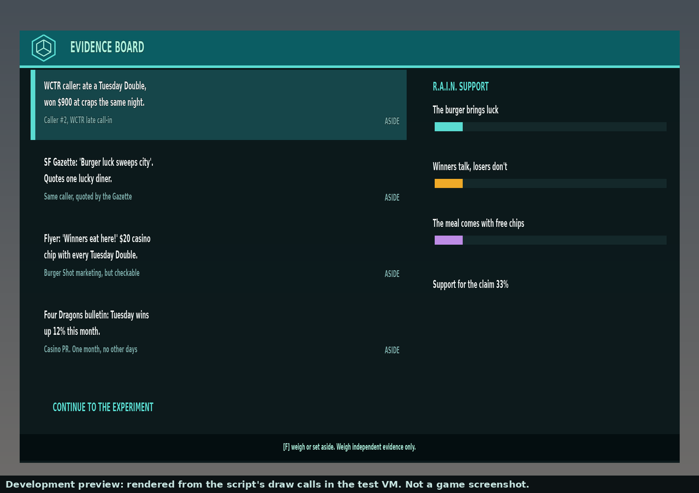
<sub>**Development preview, not a game screenshot.** The evidence board of a
research assignment, rendered from the draw calls that `v3dhq.cm` makes in the
headless test VM, with stand-in fonts on a neutral backdrop. See
[How these images were made](#how-these-images-were-made).</sub>

---

## Status, plainly

Everything here is real, compiled CLEO bytecode, built with the real **Sanny
Builder 4.2** and played end to end in a **headless script VM against a mocked
game engine**: 42 scenarios for mission 1 and 75 for the HQ and missions 2-5,
covering every ending, failure, death, arrest, checkpoint restart, retry and
save/update. **None of it has been run inside GTA: San Andreas**; no copy of
the game was available. Positions in the new missions are approximate and
snapped to the game's road and pavement nodes at runtime. Christopher's model
is built from your own `gta3.img` so that it uses the game's own skeleton.
Read [docs/KNOWN_LIMITATIONS.md](docs/KNOWN_LIMITATIONS.md) before you play.

## The storyline

| # | Mission | In one line |
|---|---|---|
| 1 | **99.9% SURE** | Flagged by CERTAIN, CJ meets Christopher, checks CERTAIN's alerts at three sites, clears a family's minivan, and crashes SureThing's live demo. |
| 2 | **Ghost Frequency** | A seven-pulse signal haunts the city's clock radios. Hunt it by ear with a direction finder, reject a loud fake and an echo off the Gant Bridge, stop a van, and decide how to publish. |
| 3 | **False Positive** | SENTINEL flags three people at once. Three clocks, any order: photograph, interview, tail and verify before a private security team decides for you. One of them really is up to something. |
| 4 | **Everything Is Connected** | A pirate-radio host says heat, ice cream, crime and the lottery are one pattern. Gather the data, call each link (cause, common cause, coincidence or can't tell), then debate him live. |
| 5 | **The Open Experiment** | Run the experiment in public while three independent groups reproduce it across town. Protect the kits, catch a saboteur, face a permit, and decide what to do with a venture capitalist's offer. |

Each mission has its own opening, objectives, checkpoints, failure
conditions, reward and ending. Several end more than one way, and the ending
you get is remembered. Full design: [docs/STORY.md](docs/STORY.md);
mission 1: [docs/MISSION_DESIGN.md](docs/MISSION_DESIGN.md).

## The lab: Vers3Dynamics HQ

After mission 1 the **?** moves a few doors down from CJ's garage, to the lab.
Walk in any time.

- **The R.A.I.N. terminal.** Eight research assignments. Each gives you a claim,
  three explanations and four evidence cards. Some cards share a source, some
  are coincidences, some are just opinions. Weigh the cards, pick one
  experiment, then accept, reject or abstain. R.A.I.N. only reads what you
  weighed. An audit grades you *careful*, *right for the wrong reasons*,
  *retraction* or *too cautious*, and the papers report it. The terminal also
  holds your investigation records and the audio settings.
- **The cymatics rig.** Tune a signal generator until a steel plate rings and
  the sand forms a pattern. The building's mains hum fakes a resonance right
  next to the first real one; switch the generator off to tell them apart. Log
  all six modes to complete the atlas.
- **The diagram wall.** Four original diagrams: R.A.I.N.'s architecture,
  CERTAIN's calibration, the plate modes, and predictions against checks.
- **Christopher** works his way round the lab. He pushes his glasses up, thinks
  out loud and turns when you come near, and he has things to say about
  everything you have been through together. He hands you the next story
  mission from a marker beside his desk.
- **The lab changes with the story:** the recovered relay, the SENTINEL audit
  binders, the correlation screens, the demo rig, and the atlas on display.

| | |
|---|---|
| 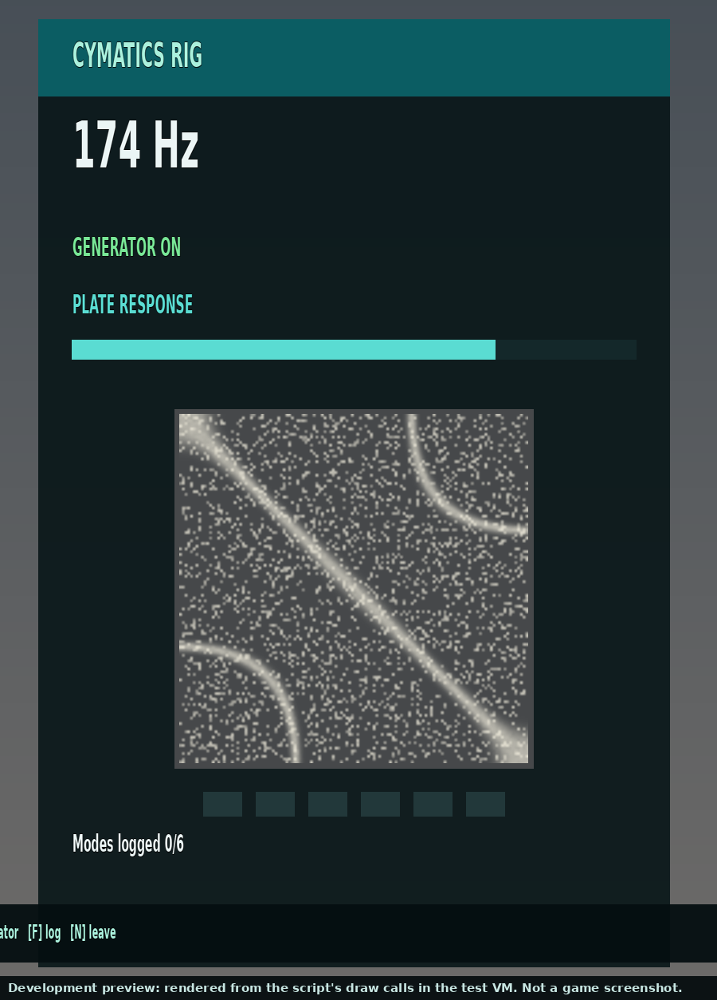 | 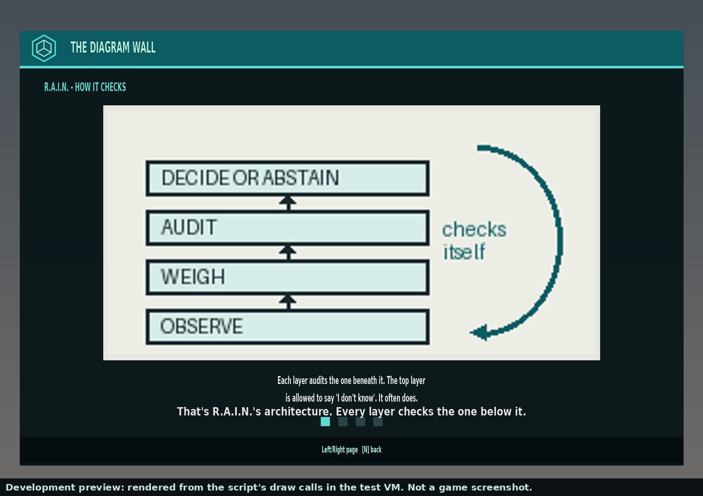 |
| The cymatics rig at the first plate mode | The diagram wall: R.A.I.N.'s architecture |
| 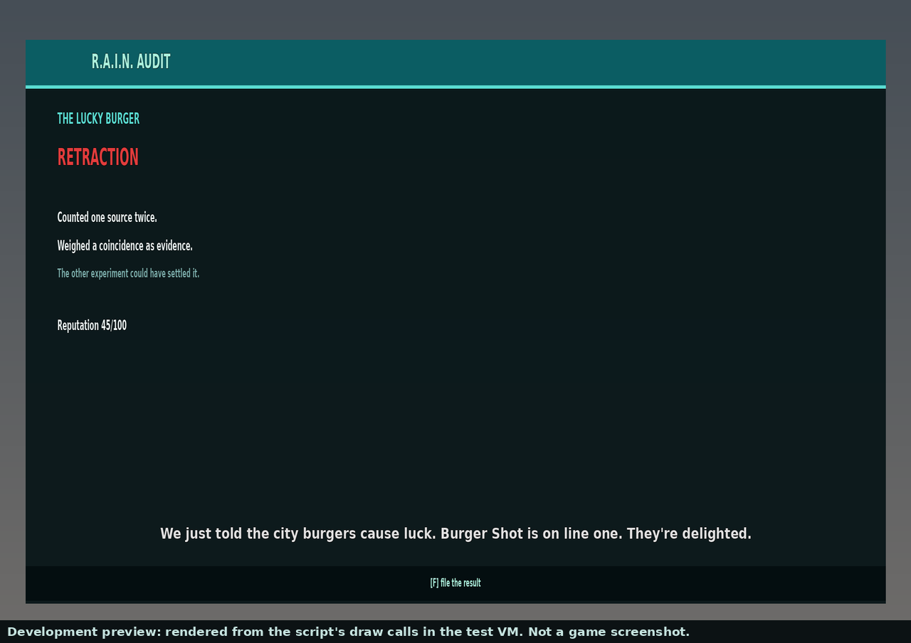 | 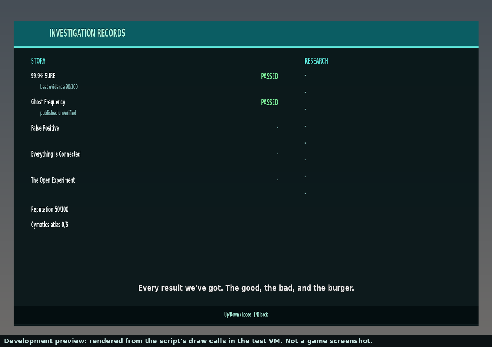 |
| An audit: weighing everything and skipping the test gets a retraction | Investigation records |

<sub>Development previews rendered from the scripts' draw calls (stand-in fonts,
neutral backdrop); not game screenshots.</sub>

## In the field

| | |
|---|---|
| 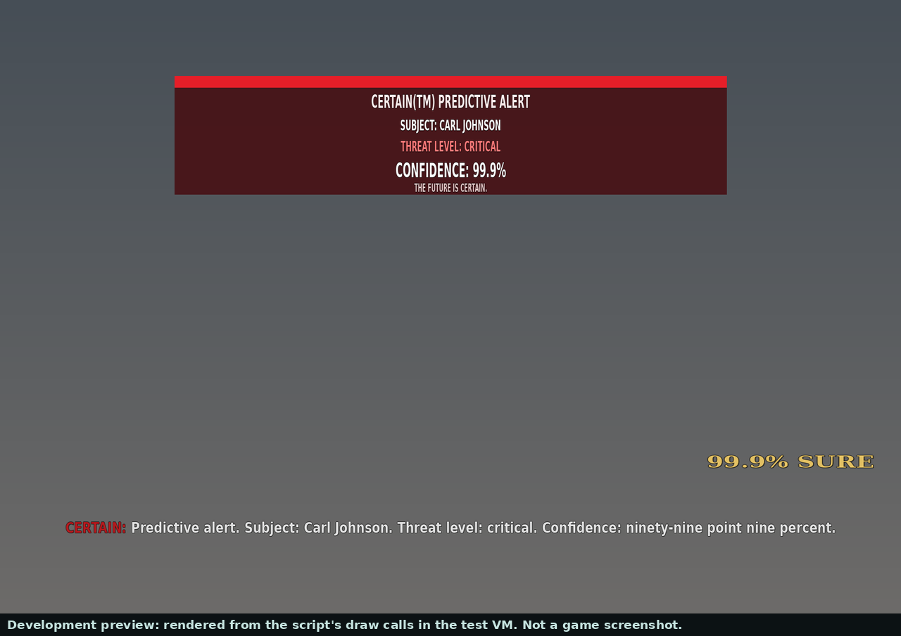 | 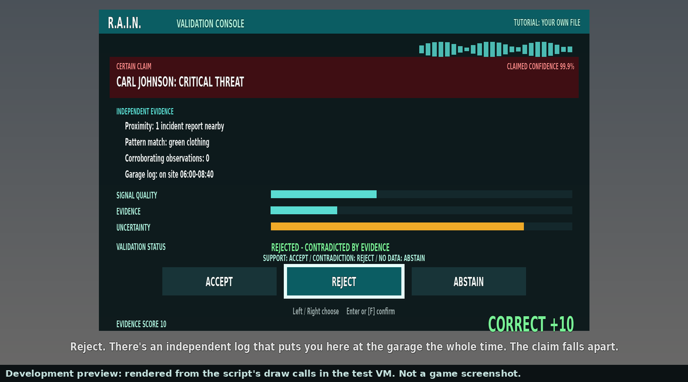 |
| *99.9% SURE*: CERTAIN flags CJ | *99.9% SURE*: the validation console |
| 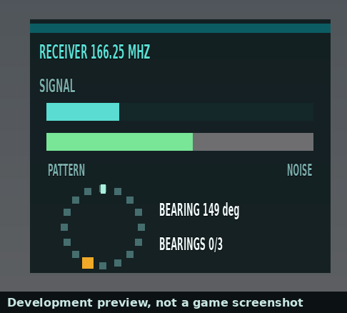 | 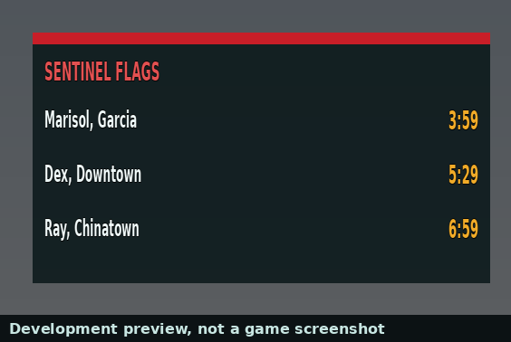 |
| *Ghost Frequency*: the direction finder | *False Positive*: three clocks |
| 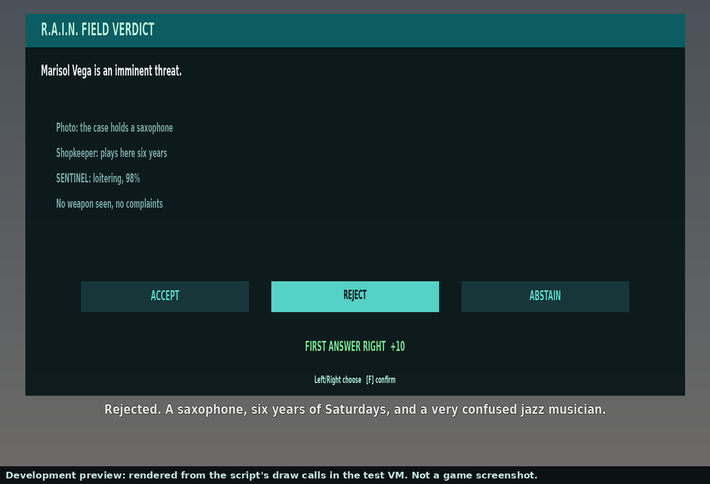 | 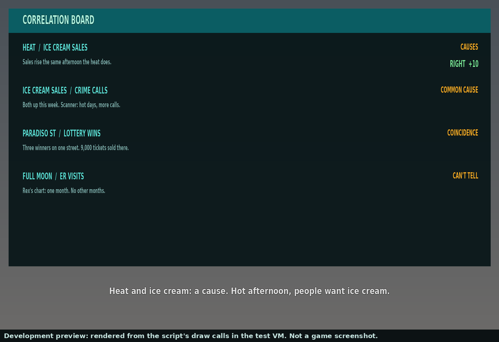 |
| *False Positive*: a field verdict | *Everything Is Connected*: the correlation board |

<sub>Development previews rendered from the scripts' draw calls; the game world
is not drawn.</sub>

## Christopher

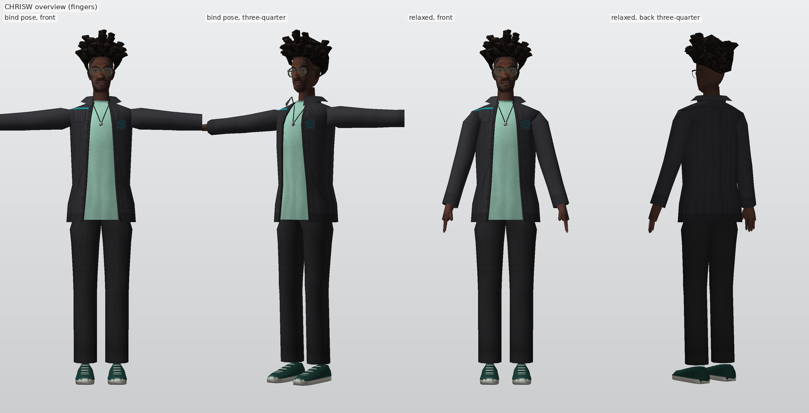
<sub>**Development preview.** The low-poly model as built by
`tools/character/build_chris.py` and rendered by `tools/character/preview_chris.py`,
on the synthetic preview skeleton. Not a game screenshot.</sub>

A San Andreas-style ped (2,997 triangles, inside the 3,000 budget) fitted to the
game's 32-bone skeleton. The jaw and brows are weighted so the game's talking
animation moves his face. The face texture is projected from the reference
photo; he has glasses with translucent lenses, the pendant, and the open jacket
with the emblem. His hands now have separate fingers. His habits (the
glasses push, the head scratch) are stock animations, and they play in mission 1
and in the lab. See [docs/CHARACTER.md](docs/CHARACTER.md).

## Sound

Everything you hear is original and synthesised for this project, with no
samples and no game audio:

- *Evidence in the Quiet*, the lab score (`tools/lab_score.py`);
- equipment room tone, R.A.I.N. interface sounds and verdict chimes, a
  generator tone whose pitch follows the dial, the plate ringing, receiver
  static and the "ghost" signal, SENTINEL's alert, a crowd
  (`tools/sound_design.py`).

All dialogue is subtitled (584 lines). Original voice recordings drop in by
file name; the recording scripts list every line. Music, ambience, voices and
effects each have a 0-10 level on the terminal, saved with your progress.

## Playtest package

The **GTA San Andreas expansion** workflow builds, tests and uploads
`99sure-vers3dynamics.zip`: the whole storyline, subtitles, textures, the lab
score *Evidence in the Quiet* and the sound effects, with a SHA-256 manifest.
It includes no GTA assets and no synthetic-skeleton character model. See the
[playtest guide](docs/PLAYTEST.md) for local packaging, installation and a
first real-game checklist.

## Quick start

1. GTA: San Andreas **PC v1.0 US** with **CLEO 5** (5.4 recommended) and
   Silent's ASI Loader.
2. **Back up your game folder and saves.**
3. Copy `release/99sure/` into the game folder, then build Christopher from
   your own `gta3.img` (one command; [docs/INSTALL.md](docs/INSTALL.md), section 4).
4. Load a save and find the **?** at CJ's garage in Doherty, San Fierro.

Progress is kept in CLEO's own save files, one per game save slot. The game's
saves are never written. Full instructions, macOS/CrossOver notes and
troubleshooting: [docs/INSTALL.md](docs/INSTALL.md).

## How it was checked

| Check | Tool | Result |
|---|---|---|
| Compile all 8 scripts | Sanny Builder 4.2 ("GTA SA v1.0 - SBL"), also under Wine 9 on Linux | 0 errors; rebuilds the original mission 1 bytecode byte for byte |
| Bytecode validation | `tools/scm/validate.py` | 0 errors, 0 warnings on every script; every text key in the FXT; every model known |
| Mission 1 | `tests/run_mission_tests.py` | 42/42 scenarios |
| HQ and missions 2-5 | `tests/run_story_tests.py` | 75/75 scenarios, at 50 ms and 200 ms frames |
| Research assignments | `tools/gen_story.py` | careful reasoning reaches every verdict |
| Christopher's model | `tools/character/validate_chris.py` | 42 checks pass; DragonFF and librw cross-checks when those are installed |
| Audio and package | `tests/test_playtest.py` | every sound renders, loops cleanly, keeps headroom; the ZIP's hashes verify |
| **In game** | - | **not run** (checklist in [docs/TESTING.md](docs/TESTING.md)) |

The VM executes the compiled bytecode with the engine's own control-flow
rules: an 8-deep gosub stack, the death/arrest unwind, and CLEO's save
behaviour. It fails a run on stale handles, unloaded models or animations,
text or rectangle limits, path lookups outside streamed data, and anything a
script leaves behind. A scripted player drives it through pad input and the
same objectives the HUD shows. Details: [docs/TESTING.md](docs/TESTING.md).

## Building

```
python3 tools/build.py                          # regenerate, validate, test, package release/99sure
python3 tools/build.py --sb4 <SannyBuilder4>    # also recompile every src/*.txt
python3 tools/build.py --img <gta3.img>         # build Christopher on your own stock skeleton
python3 tools/package_playtest.py --out build/99sure-vers3dynamics.zip
```

Python 3.10+ with numpy and Pillow; ffmpeg (with libvorbis) for audio; Wine
and xvfb-run to compile on Linux. CI runs the whole build and every test, and
uploads the package as an artifact.

## How these images were made

There is no game footage here, because the game was not available. The
interface images show what the compiled scripts draw. The test runners record
each distinct interface state's draw calls (`--frames`), and
`tools/readme_media.py` re-renders the chosen ones with `tests/vm/render_ui.py`,
crops them and labels each image. Positions, sizes, colours, text and sprites
come from the scripts. The fonts are stand-ins, key prompts are shown as
default PC keys, and the world behind is a flat gradient, so in the game the
panels sit over the city. The character image is a software render of the
model file. Real screenshots are welcome: see the in-game checklist in
[docs/TESTING.md](docs/TESTING.md).

## Layout

```
src/          mission 1, the HQ, missions 2-5, the launcher (Sanny Builder 4)
  v3d/        shared core, interface, field helpers, verdict console
  hq/ ghost/ false/ link/ open/   per-script variables and modules
dialogue/     mission 1 lines and claims; story/ for the expansion and research assignments
data/         prop and crowd layouts per script
assets/       sprite sources, character textures and previews
tools/        generators, build, compiler wrapper, validator, RenderWare library, character, sound
tests/        script VM, mocked engine, scripted players, scenarios, UI renderer
release/      the files to copy into the game
docs/         install, story, mission design, testing, calibration, character, limitations
```

## Credits and licences

Story, dialogue, code, sprites, diagrams, music and sound effects are original
work for this project. GTA: San Andreas is © Rockstar Games; this mod contains
no game files and works only with your own copy. Engine behaviour was checked
against the gta-reversed project, the CLEO 5 and librw sources, and the Sanny
Builder library. The *Green Machine* recordings elsewhere in this repository
are not part of this mod (see [../docs/SOUNDTRACK.md](../docs/SOUNDTRACK.md)).

Christopher Woodyard's likeness, the Vers3Dynamics name and its tagline are
used as specified in the mission brief, from the reference photo and concept
art supplied with it.
